**Résultats et interprétation des tendances climatiques actuels et
futurs au Bénin**

**1. Régimes mensuels des paramètres climatiques (1991-2024)**

La figure 1 présente les régimes pluviométriques mensuels moyens des
huit Zones Agro-Écologiques (ZAE) du Bénin sur la période 1991-2024.
Elle met en évidence une variation latitudinale des régimes saisonniers,
marquée par le passage progressif d’un régime unimodal au Nord et au
Centre vers un régime bimodal dans la partie méridionale du pays.

Dans les ZAE 1 à ZAE 4, correspondant à la zone soudanienne et à la zone
soudano-guinéenne du Nord et du Centre-Nord, le régime pluviométrique
est unimodal. La saison pluvieuse s’étend de mai à septembre ou octobre,
avec une installation progressive des pluies à partir d’avril-mai, un
pic unique en août et un arrêt progressif des précipitations en octobre.
Les cumuls mensuels moyens atteignent 321 mm en ZAE 1, tandis qu’ils se
situent entre 242 et 279 mm en août dans les ZAE 2 à 4 (soit 279 mm en
ZAE 2, 261 mm en ZAE 3 et 242 mm en ZAE 4). Cette saison pluvieuse est
encadrée par une longue saison sèche, de novembre à mars, au cours de
laquelle les précipitations deviennent très faibles, voire quasi nulles
(inférieures à 10 mm en ZAE 1-2 et à 22 mm en ZAE 3-4). La ZAE 5
constitue une zone de transition entre les régimes soudano-guinéen et
subéquatorial. La saison pluvieuse y est plus longue, s’étendant d’avril
à octobre, avec des précipitations relativement élevées entre juillet et
septembre, de l’ordre de 180 à 205 mm par mois.

Dans les ZAE 6, ZAE 7 et ZAE 8, situées dans la partie méridionale du
pays, le régime pluviométrique est bimodal, typique du climat
subéquatorial. Il est caractérisé par une grande saison pluvieuse
d’avril à juillet, avec un pic en juin, suivie d’une petite saison sèche
en août, puis d’une petite saison pluvieuse de septembre à octobre. Les
cumuls mensuels moyens culminent autour de 149 à 227 mm au cours de la
grande saison pluvieuse (165 mm en mai en ZAE 6, 149 mm en juin en ZAE 7
et 227 mm en juin en ZAE 8), avec des valeurs particulièrement élevées
dans la ZAE 8, zone littorale soumise à une forte humidité
atmosphérique. La petite saison pluvieuse enregistre en moyenne 142 à
178 mm par mois (142-152 mm en ZAE 6, 178 mm en septembre en ZAE 7 et
149-152 mm en ZAE 8), tandis que le recul des précipitations en août
varie entre 48 et 102 mm (53 mm en ZAE 6, 102 mm en ZAE 7 et 48 mm en
ZAE 8).

<figure>
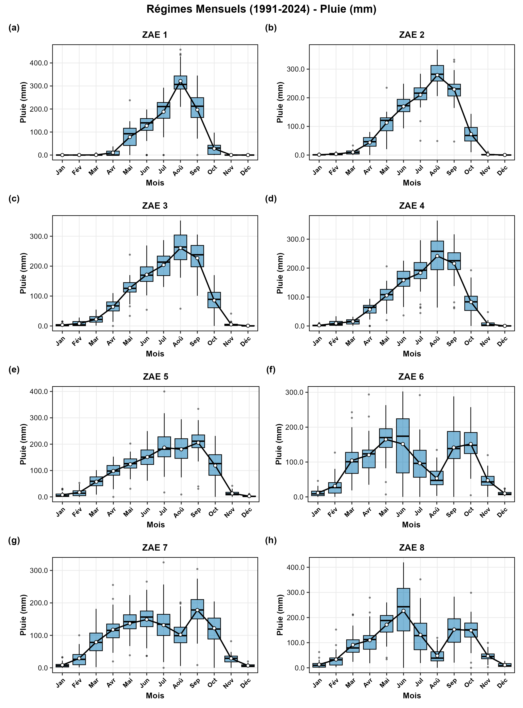
<figcaption>
<strong>Figure 1:</strong> Évolution mensuelle des
précipitations (mm) dans les huit Zones Agro-Écologiques du Bénin sur la
période 1991-2024
</figcaption>
</figure>

Les figures 2, 3 et 4 présentent l’évolution saisonnière des
températures maximales ($`T_{\max}`$), minimales ($`T_{\min}`$) et
moyennes ($`T_{moy}`$) sur la période 1991-2024. Les régimes thermiques
évoluent globalement à l’inverse du régime pluviométrique : les
températures sont les plus élevées pendant la saison sèche, puis
diminuent progressivement avec l’installation des pluies, en raison de
l’augmentation de la couverture nuageuse, de l’humidité atmosphérique et
des précipitations.Au Nord et au Centre-Nord du pays (ZAE 1 à ZAE 4),
les températures maximales et moyennes atteignent leurs valeurs les plus
élevées en mars-avril, à la fin de la saison sèche. La température
maximale moyenne culmine à 40,5 °C en avril dans la ZAE 1, tandis
qu’elle se situe entre 38,2 et 39,2 °C en mars dans les ZAE 2 à 4. Les
températures moyennes atteignent alors 31,3 à 33,4 °C. Dans la ZAE 5,
zone de transition, le maximum thermique est observé en février-mars,
avec une température maximale moyenne de 37,3 °C et une température
moyenne de 30,9 °C.Dans la partie méridionale du pays (ZAE 6 à ZAE 8),
les températures maximales et moyennes sont les plus élevées en
février-mars. Les températures maximales moyennes varient entre 34,9 et
36,8 °C, avec 35,7 °C en ZAE 6, 36,8 °C en ZAE 7 et 34,9 °C en ZAE 8 en
février. Les températures moyennes atteignent alors 30,1 à 30,6 °C.
Cette hausse thermique correspond à la fin de la grande saison sèche,
avant l’installation de la grande saison pluvieuse.Avec l’arrivée des
pluies, les températures diminuent progressivement et atteignent leurs
valeurs les plus faibles en août, au cœur de la saison pluvieuse. Sur
l’ensemble du pays, les températures moyennes se situent alors entre
25,9 et 27,1 °C, tandis que les températures maximales moyennes varient
entre 29,7 et 31,3 °C. Cette baisse traduit l’effet des précipitations,
de la forte nébulosité et de l’augmentation de l’humidité relative sur
le bilan radiatif et le confort thermique.Après le retrait des pluies,
une remontée des températures est observée à partir d’octobre ou
novembre, selon les zones. Au Nord, les températures maximales moyennes
augmentent à nouveau, atteignant environ 35,4 à 37,1 °C en novembre,
tandis qu’elles varient entre 33,3 et 34,5 °C dans la partie
méridionale. Dans la ZAE 1, ce second pic thermique apparaît dès
octobre, tandis que sur le littoral, il est observé plus tardivement, en
décembre.L’amplitude thermique saisonnière augmente nettement du Sud
vers le Nord. Les températures minimales diminuent fortement en
décembre-janvier dans les ZAE 1 à 4, sous l’influence de l’harmattan,
atteignant 16,8 °C en ZAE 1, 18,4 °C en ZAE 2, 19,3 °C en ZAE 3 et 17,8
°C en ZAE 4. Dans la ZAE 5, les températures minimales moyennes sont de
l’ordre de 21,1 °C. En revanche, dans les zones méridionales et
littorales, les températures minimales restent relativement élevées et
moins variables au cours de l’année. Elles oscillent entre 22,4 et 25,3
°C dans les ZAE 6 et 7, et entre 23,1 et 25,8 °C dans la ZAE 8.

<figure>
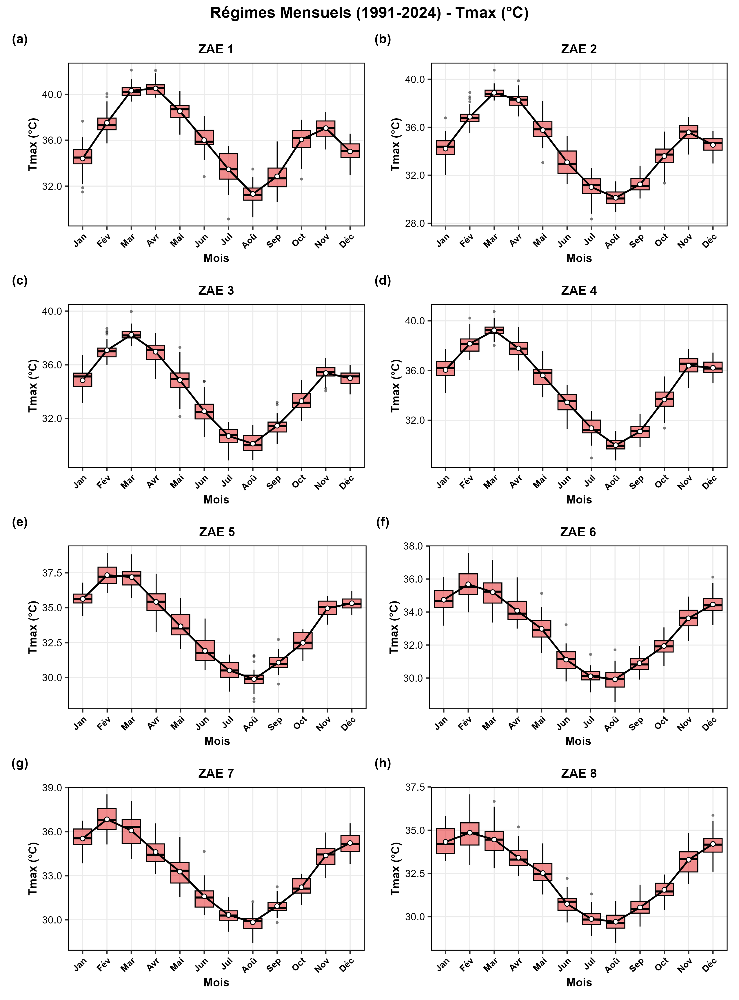
<figcaption>
<strong>Figure 2:</strong> Variation mensuelle des
températures maximales dans les huit ZAE du Bénin
(1991-2024)
</figcaption>
</figure>

<figure>
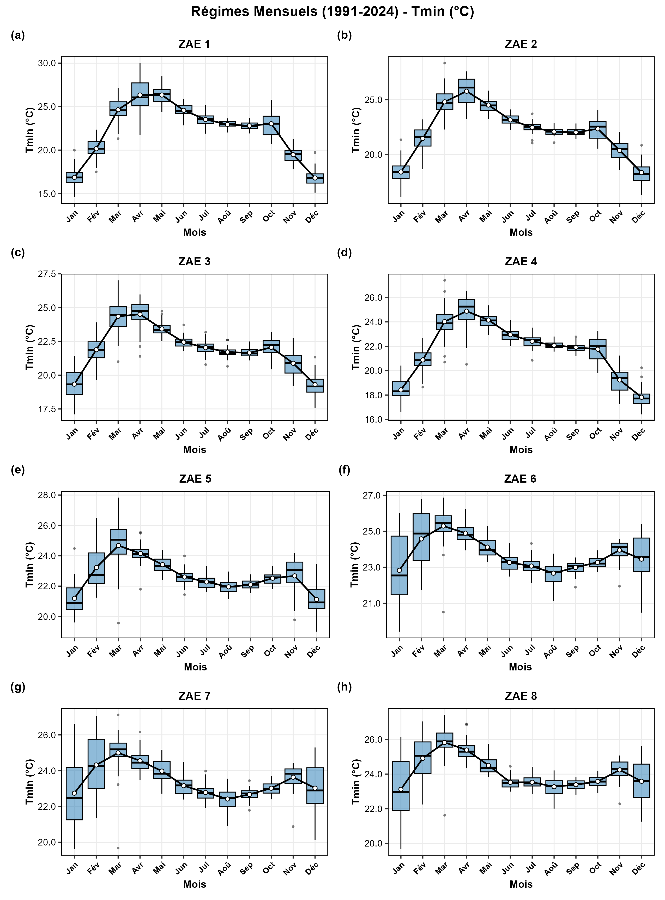
<figcaption>
<strong>Figure 3:</strong>Variation mensuelle des
températures minimales dans les huit ZAE du Bénin
(1991-2024)
</figcaption>
</figure>

<figure>
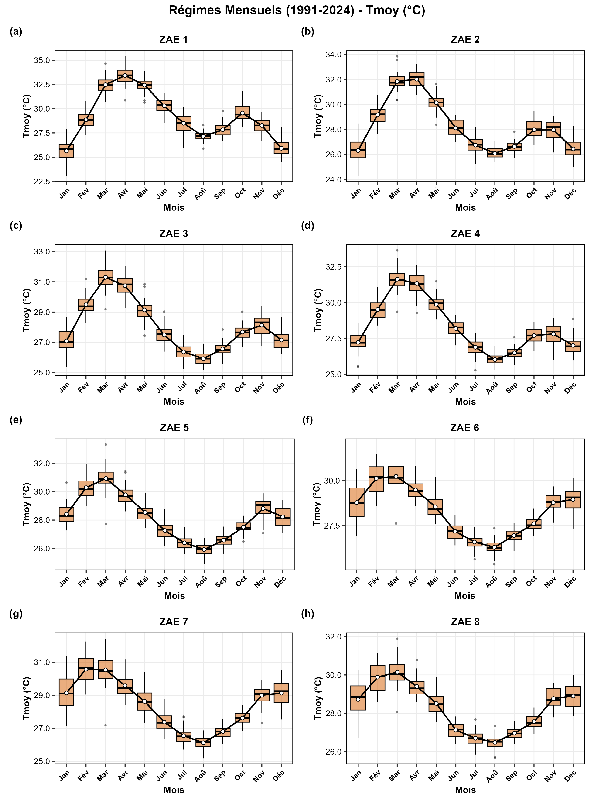
<figcaption>
<strong>Figure 4:</strong> Variation mensuelle des
températures moyennes dans les huit ZAE du Bénin
(1991-2024)
</figcaption>
</figure>

Les figures 5, 6 et 7 présentent respectivement l’évolution saisonnière
de l’humidité relative ($`HR`$), de la vitesse du vent et de
l’évapotranspiration potentielle ($`ETP`$) sur la période 1991-2024. Ces
trois variables évoluent de manière cohérente avec le régime
pluviométrique et thermique du pays, en traduisant l’alternance entre la
saison sèche, dominée par l’harmattan, et la saison pluvieuse, marquée
par une forte humidité atmosphérique.

L’humidité relative (Figure 5) augmente progressivement avec
l’installation de la saison pluvieuse et diminue fortement pendant la
saison sèche. Dans les ZAE 1 à 4, situées au Nord et au Centre-Nord,
l’air devient particulièrement sec de janvier à mars, sous l’influence
de l’harmattan. Les valeurs minimales sont observées en février, avec
une humidité relative moyenne comprise entre 24 et 30%. Avec l’arrivée
des pluies, l’humidité relative augmente fortement et dépasse 80% en
août-septembre. Dans les ZAE 6 à 8, situées dans la partie méridionale
du pays, l’humidité relative reste globalement plus élevée tout au long
de l’année. Elle varie entre 61 et 73% en janvier, puis atteint 82 à 85%
de juin à octobre, en lien avec la proximité de l’océan Atlantique et
l’influence des masses d’air maritimes humides.

La vitesse du vent (Figure 6) présente également une organisation
saisonnière distincte entre le Nord et le Sud du pays. Dans les ZAE 1 à
4, le régime est globalement unimodal, avec des vitesses plus élevées en
février-avril, atteignant 2,2 à 2,6 m/s, et des valeurs plus faibles en
septembre-octobre, comprises entre 1,2 et 1,5 m/s. Dans la partie
méridionale, le profil est davantage bimodal et influencé par les brises
marines. Les vitesses du vent augmentent en mars, avec des valeurs de
1,8 à 2,6 m/s, puis atteignent un second maximum en juillet-août,
pouvant dépasser 2,9 m/s dans la ZAE 8.

L’évapotranspiration potentielle (Figure 7) atteint son maximum en mars
sur l’ensemble du territoire. Les valeurs les plus élevées sont
observées dans les ZAE 1 et 4, avec 205 à 210 mm par mois, tandis
qu’elles varient entre 160 et 175 mm par mois dans les ZAE 6 à 8. Ce
maximum correspond à la fin de la saison sèche, période durant laquelle
les températures sont élevées, l’humidité relative faible et le
rayonnement solaire important. Avec l’installation des pluies, l’ETP
diminue progressivement et atteint son minimum en août, avec des valeurs
comprises entre 118 et 142 mm par mois.

<figure>
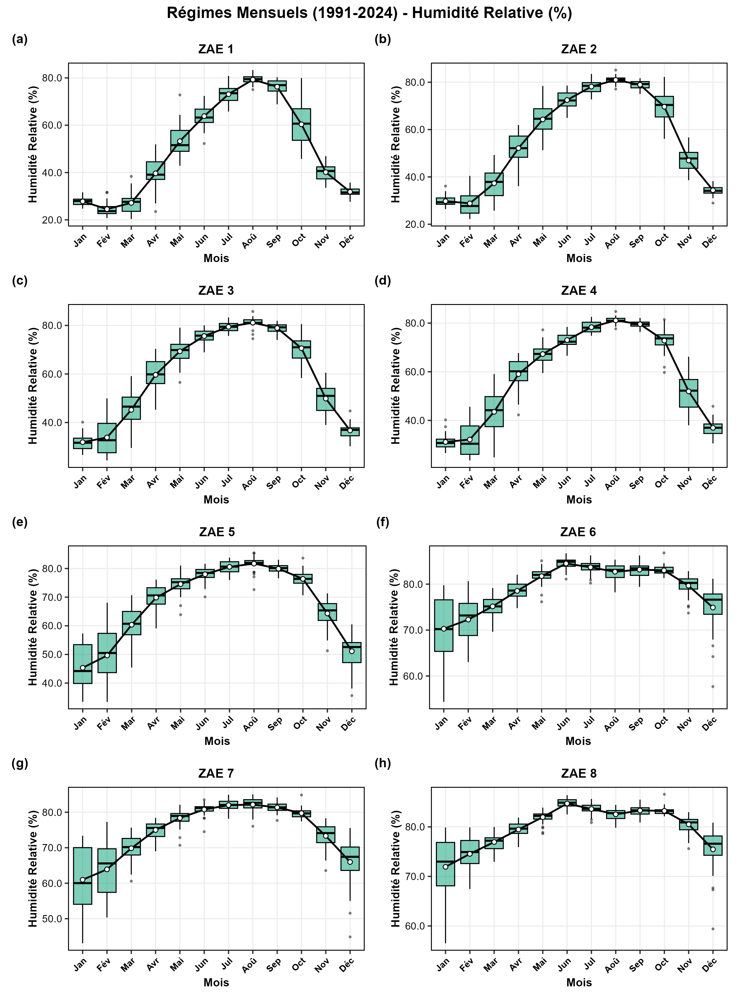
<figcaption>
<strong>Figure 5:</strong> Régimes mensuels de l’humidité
relative (%) par ZAE (1991-2024)
</figcaption>
</figure>

<figure>
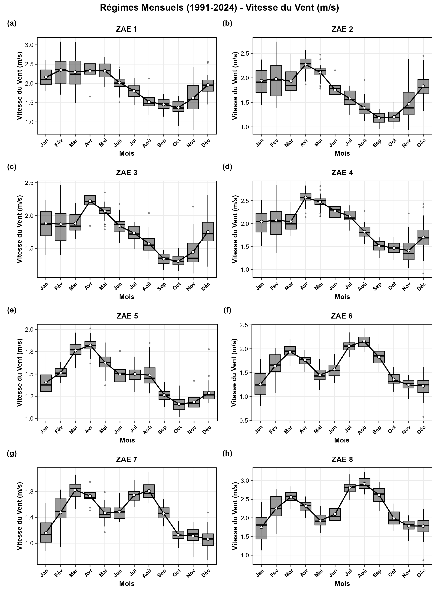
<figcaption>
<strong>Figure 6:</strong> Régimes mensuels de la vitesse
du vent (m/s) par ZAE (1991-2024)
</figcaption>
</figure>

<figure>
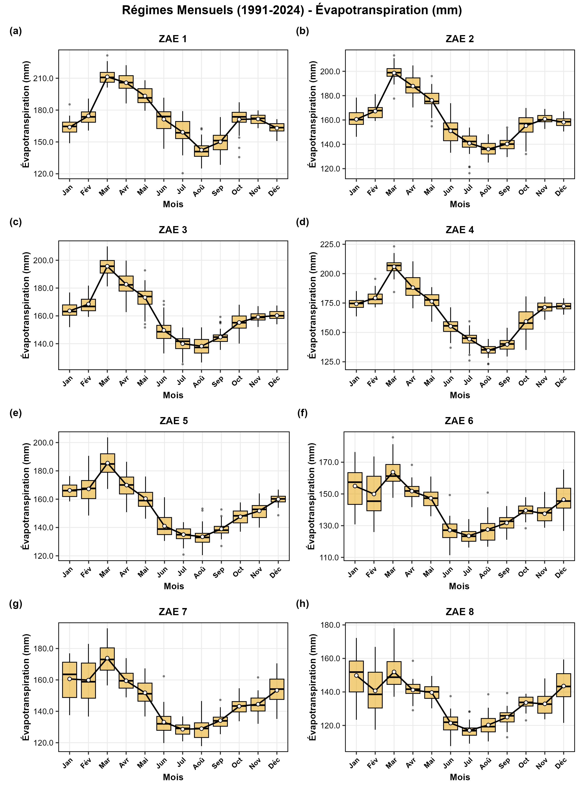
<figcaption>
<strong>Figure 7:</strong>Régimes mensuels de
l’évapotranspiration potentielle (mm) par ZAE
(1991-2024)
</figcaption>
</figure>

**Tendances climatiques interannuelles (1991-2024)**

La figure 8 présente l’évolution interannuelle des cumuls
pluviométriques annuels dans les huit Zones Agro-Écologiques (ZAE) du
Bénin entre 1991 et 2024. L’analyse des séries pluviométriques met en
évidence une forte variabilité interannuelle, marquée par l’alternance
d’années déficitaires et d’années excédentaires.Les années
particulièrement déficitaires sont observées en 1992, 1997, 2001 ainsi
qu’au cours de la période 2013-2015. À l’inverse, les années 1994, 2003,
2010 et 2019 se caractérisent par des cumuls pluviométriques annuels
plus élevés. Cette alternance traduit l’irrégularité de la répartition
des précipitations au cours de la période étudiée, sans nécessairement
traduire une baisse durable des apports pluviométriques annuels. Sur
l’ensemble du territoire, aucune tendance linéaire statistiquement
significative n’est observée au seuil de 5% selon le test de
Mann-Kendall. Les valeurs de $`p\`$sont supérieures à 0,16 et les
coefficients de détermination $`R^{2}\`$restent faibles, inférieurs ou
égaux à 0,076. Ces résultats indiquent que les fluctuations observées ne
traduisent pas une évolution linéaire claire et généralisée des
précipitations annuelles.

Les pentes de Sen confirment cette absence de tendance marquée. Dans les
ZAE 1, 2, 6 et 7, une légère augmentation non significative des cumuls
annuels est observée, avec des valeurs comprises entre +31,9 et +42,1 mm
par décennie et des valeurs de $`p`$supérieures ou égales à 0,164. Dans
les ZAE 3, 4, 5 et 8, les précipitations annuelles apparaissent quasi
stationnaires, avec des pentes faibles comprises entre +3,5 et +13,8 mm
par décennie et des valeurs de p supérieures à 0,72.

<figure>
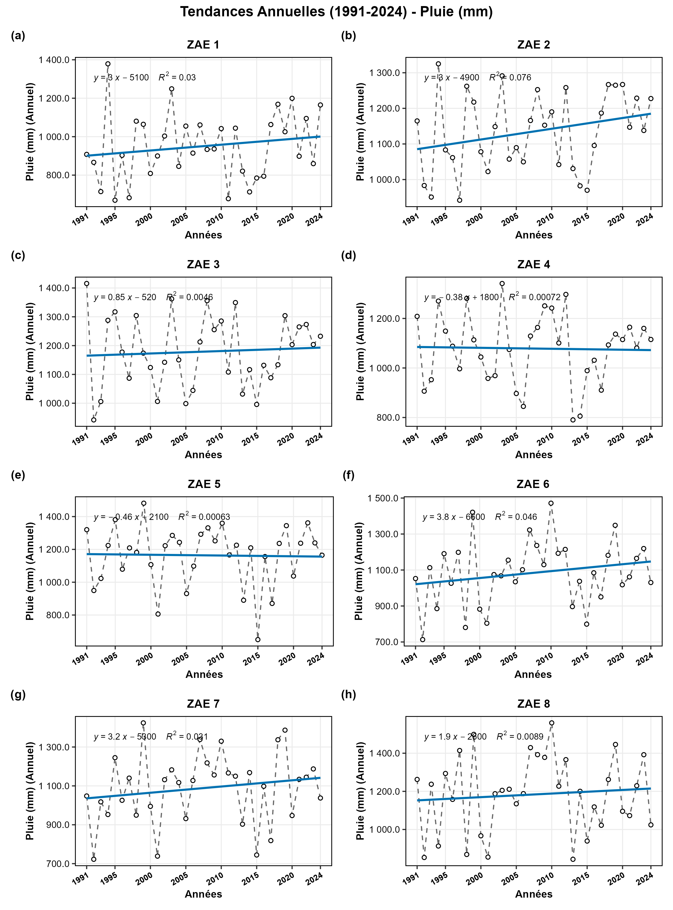
<figcaption>
<strong>Figure 8:</strong>Évolution interannuelle des
cumuls pluviométriques annuels (mm) dans les huit ZAE du Bénin de 1991 à
2024
</figcaption>
</figure>

Les figures 9, 10 et 11 illustrent respectivement l’évolution
interannuelle des températures moyennes ($`T_{moy}`$, Figure 9),
maximales ($`T_{\max}`$, Figure 10) et minimales ($`T_{\min}`$, Figure
11) sur l’ensemble du territoire béninois entre 1991 et 2024.

La température moyenne annuelle (Figure 9) augmente de manière très
significative dans toutes les ZAE, avec des valeurs de $`p`$ inférieures
ou égales à 0,002 et des coefficients de détermination ($`R^{2}`$)
compris entre 0,30 et 0,72. Le réchauffement est plus marqué dans les
zones du Centre et du Sud-Centre du pays. Dans la ZAE 7, l’augmentation
atteint +0,353 °C par décennie, avec un coefficient de corrélation de
rang de Mann-Kendall $`\tau = 0,626`$ et une valeur de $`p < 0,001`$.
Dans la ZAE 5, la tendance est de +0,347 °C par décennie, avec
$`\tau = 0,683`$ et $`p < 0,001`$. Dans la ZAE 1, le réchauffement est
plus modéré, avec une augmentation de +0,190 °C par décennie
($`\tau = 0,373`$) et une valeur de $`p = 0,002`$.

Cette hausse des températures moyennes est portée à la fois par
l’augmentation des températures maximales (Figure 10) et par celle des
températures minimales (Figure 11).

Les températures maximales augmentent de manière particulièrement
marquée dans les ZAE 7 et 5, avec des tendances de +0,475 °C par
décennie ($`\tau = 0,643`$) et +0,447 °C par décennie ($`\tau = 0,665`$)
respectivement, pour des valeurs de $`p < 0,001`$. Dans la ZAE 1,
l’augmentation est plus faible, avec +0,133 °C par décennie
($`\tau = 0,234`$) et une valeur de $`p = 0,054`$, ce qui indique une
tendance non significative au seuil de 5 %.

Parallèlement, les températures minimales (Figure 11) progressent de
façon homogène et très significative dans toutes les ZAE
($`p \leq 0,0019`$), à un rythme compris entre +0,223 °C par décennie en
ZAE 3 ($`\tau = 0,544`$, $`p < 0,001`$) et +0,271 °C par décennie en ZAE
7 ($`\tau = 0,415`$, $`p < 0,001`$), confirmant un réchauffement
généralisé sur l’ensemble du territoire.

<figure>
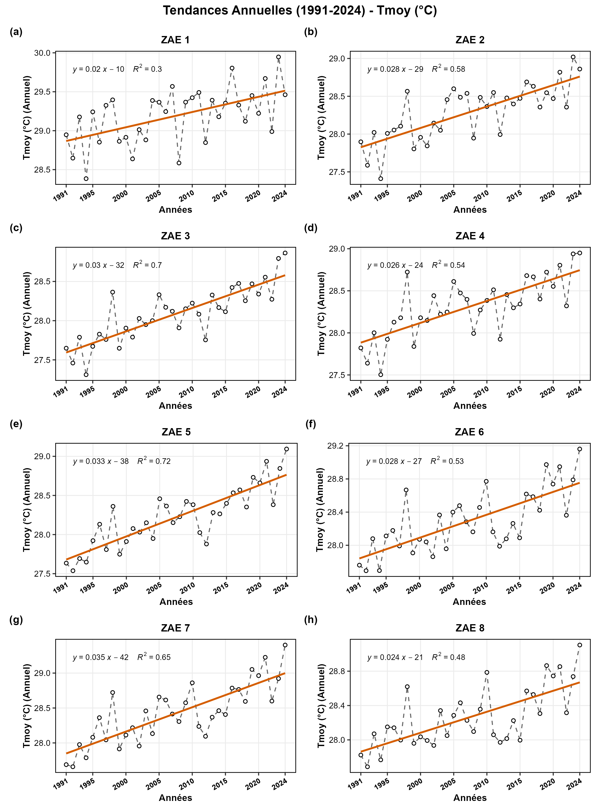
<figcaption>
<strong>Figure 9:</strong> Tendances interannuelles des
températures moyennes dans les huit ZAE du Bénin
(1991-2024)
</figcaption>
</figure>

<figure>
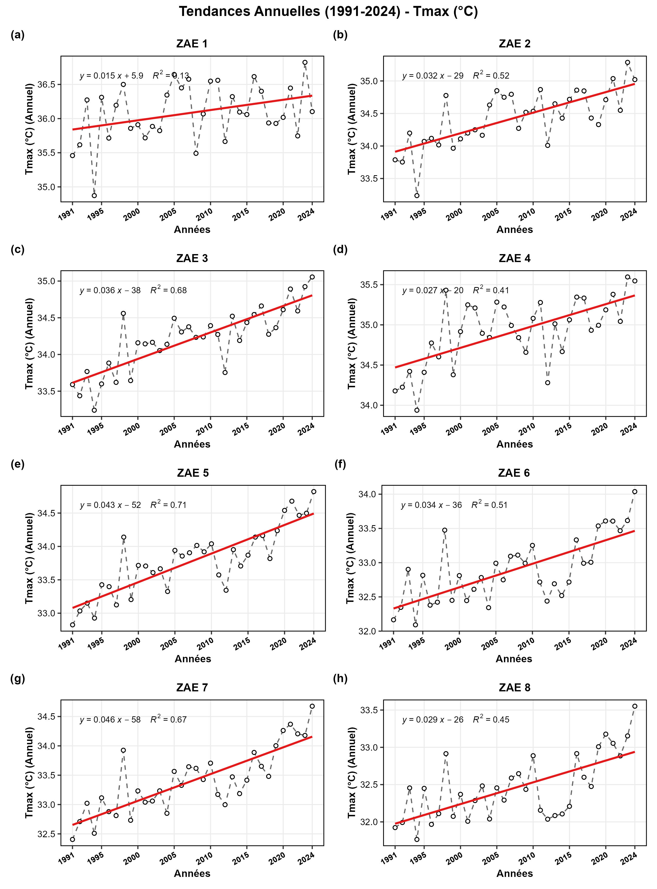
<figcaption>
<strong>Figure 10:</strong> Tendances interannuelles des
températures maximales (°C) dans les huit ZAE du Bénin
(1991-2024)
</figcaption>
</figure>

<figure>
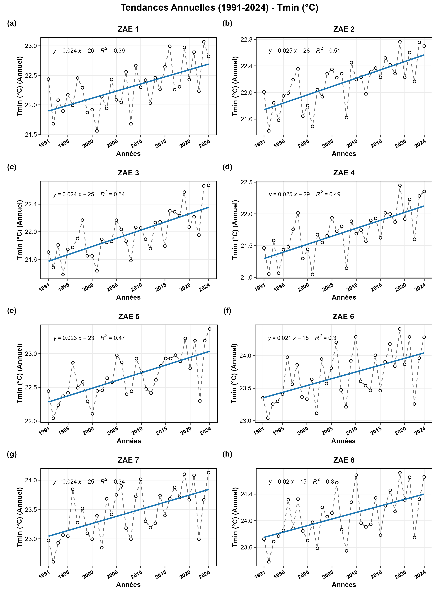
<figcaption>
<strong>Figure 11:</strong>Tendances interannuelles des
températures moyennes minimales (°C) dans les huit ZAE du Bénin
(1991-2024)
</figcaption>
</figure>

Les figures 12, 13 et 14 présentent l’évolution interannuelle de
l’humidité relative annuelle, de la vitesse du vent et de
l’évapotranspiration potentielle ($`ETP`$) sur la période 1991-2024.
Elles mettent en évidence les répercussions du réchauffement observé sur
les conditions atmosphériques et sur le bilan hydrique.

L’humidité relative annuelle (Figure 12) affiche une tendance
significative à la baisse dans cinq des huit ZAE. Cette diminution est
particulièrement marquée à partir de 2019. Les tendances les plus fortes
sont observées dans le Centre et le Nord-Est du pays, notamment dans les
ZAE 5, 3 et 7. Dans la ZAE 5, l’humidité relative diminue de -1,368% par
décennie, avec un coefficient de corrélation de rang de Mann-Kendall
$`\tau = - 0,412`$et une valeur de $`p = 0,0007`$. Dans la ZAE 3, la
baisse atteint -1,178% par décennie, avec $`p = 0,007`$, tandis que dans
la ZAE 7, elle est de -1,140% par décennie, avec $`p = 0,0023`$. En
revanche, aucune tendance significative n’est observée dans les ZAE 1, 4
et 8, où les valeurs de $`p`$sont supérieures à 0,05.

La vitesse du vent (Figure 13) reste globalement stationnaire dans sept
des huit ZAE, avec des valeurs de $`p\`$supérieures à 0,37. Seule la ZAE
1, située à l’Extrême-Nord du pays, présente une légère diminution
statistiquement significative, avec une tendance de -0,039 m/s par
décennie et une valeur de $`p = 0,047`$. Cette baisse reste toutefois
faible en valeur absolue et ne traduit pas une évolution marquée des
régimes de vent à l’échelle nationale.

L’évapotranspiration potentielle annuelle (Figure 14) augmente de
manière significative dans sept des huit ZAE, avec des valeurs de
$`p`$inférieures ou égales à 0,017. Les tendances les plus élevées sont
observées dans les ZAE 7 et 5. Dans la ZAE 7, l’ETP augmente de +33,73
mm par décennie, avec $`\tau = 0,487`$et $`p = 0,0001`$. Dans la ZAE 5,
l’augmentation atteint +31,64 mm par décennie, avec $`\tau = 0,504`$et
$`p < 0,0001`$. Seule la ZAE 1 ne présente pas de tendance
significative, avec une valeur de $`p = 0,6565`$.

<figure>
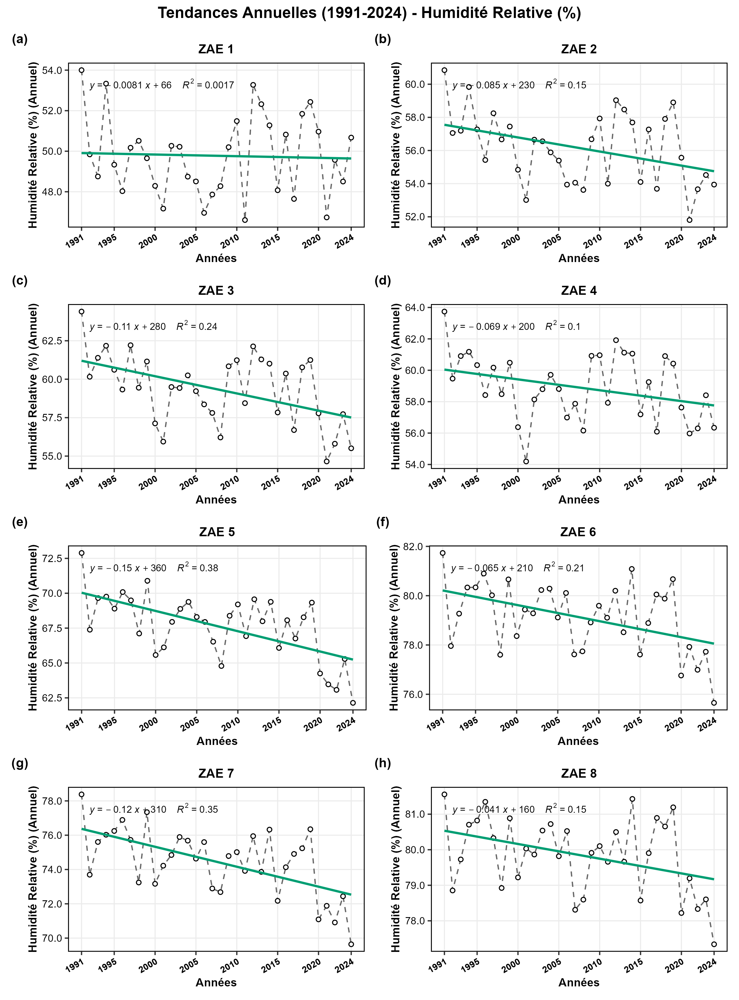
<figcaption>
<strong>Figure 12 :</strong> Tendances interannuelles de
l’humidité relative (%) par ZAE (1991-2024)
</figcaption>
</figure>

<figure>
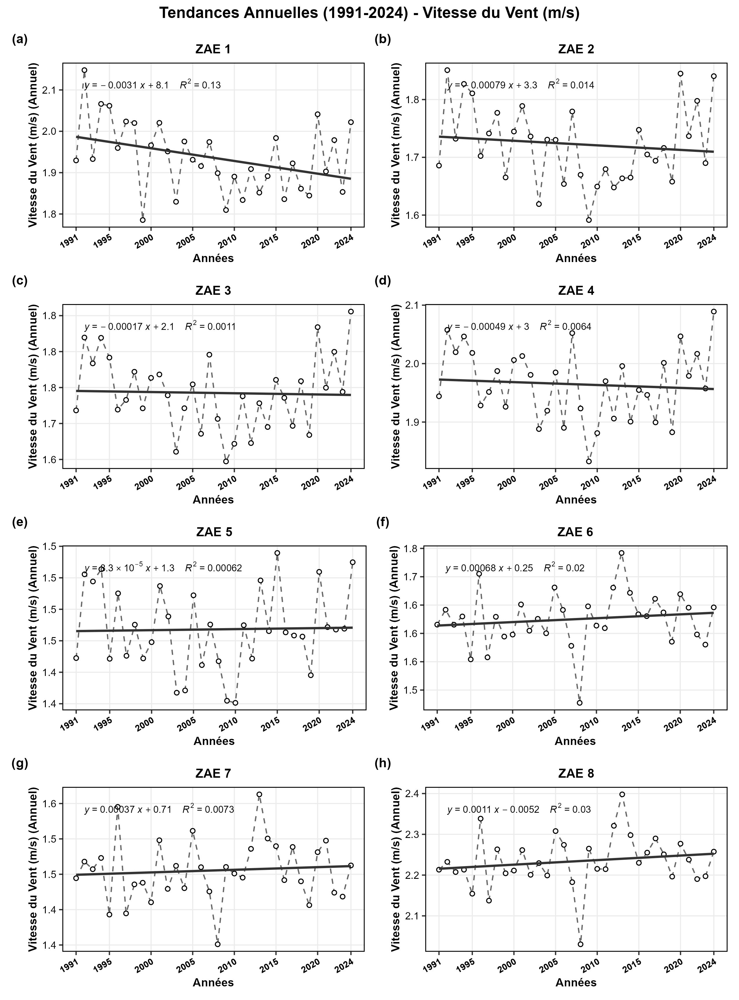
<figcaption>
<strong>Figure 13 :</strong> Tendances interannuelles de
la vitesse du vent (m/s) par ZAE (1991-2024)
</figcaption>
</figure>

<figure>
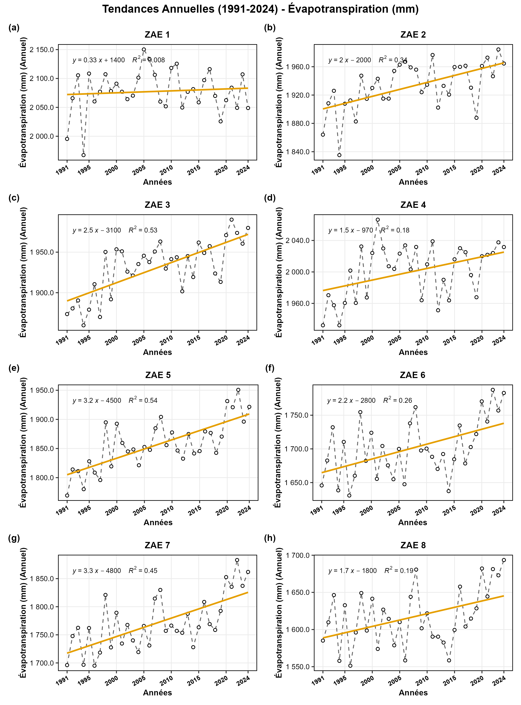
<figcaption>
<strong>Figure 14:</strong>Tendances interannuelles de
l’évapotranspiration potentielle (mm) par ZAE
(1991-2024)
</figcaption>
</figure>

**Bilan climatique mensuel moyen (BC = P - ETP)**

La figure 15 présente le bilan climatique mensuel moyen
($`BC = P - ETP`$) dans les huit Zones Agro-Écologiques (ZAE) du Bénin
sur la période 1991-2024. Cet indicateur permet d’identifier les mois au
cours desquels les précipitations sont supérieures à
l’évapotranspiration potentielle, correspondant à des excédents
hydriques, ainsi que les mois de déficit hydrique, lorsque
l’évapotranspiration potentielle dépasse les précipitations.

Sur l’ensemble du territoire, les mois déficitaires ($`BC < 0`$)
dominent largement l’année. Toutefois, leur répartition saisonnière
diffère nettement entre le Nord, le Centre et le Sud du pays. Dans les
ZAE 1 à 4, le déficit hydrique s’étend sur huit à neuf mois,
généralement d’octobre à mai ou juin. Au cours de cette période, les
déficits mensuels atteignent -160 à -210 mm entre janvier et avril. La
période excédentaire ($`BC > 0`$) est plus courte et se concentre sur
une seule fenêtre de trois mois dans les ZAE 1 et 4, de juillet à
septembre, avec un pic de +175 mm en août dans la ZAE 1. Dans les ZAE 2
et 3, la période excédentaire s’étend sur quatre mois, de juin à
septembre, avec des valeurs comprises entre +120 et +145 mm en août.

Dans la ZAE 5, zone de transition entre le Nord et le Sud, l’excédent
hydrique s’étale également sur quatre mois, de juin à septembre, avec
des valeurs mensuelles comprises entre +45 et +65 mm. Cette
configuration traduit une saison pluvieuse plus étalée que dans les
zones septentrionales, mais moins marquée que dans la partie méridionale
du pays.

Dans les ZAE 6 à 8, situées dans la partie méridionale du pays, le bilan
climatique présente une organisation bimodale. Une première phase
excédentaire est observée durant la grande saison pluvieuse, entre mai
et juillet selon les zones. Dans la ZAE 6, l’excédent est observé en
mai-juin, avec des valeurs de +20 à +25 mm. Dans la ZAE 7, il intervient
en juin-juillet, avec des valeurs de +3 à +15 mm. Dans la ZAE 8,
l’excédent s’étend de mai à juillet et culmine à +105 mm en juin. Cette
première phase excédentaire est interrompue par un déficit hydrique en
août, compris entre -28 et -75 mm, correspondant à la petite saison
sèche. Un second excédent, plus modéré, est ensuite observé en
septembre-octobre, avec des valeurs comprises entre +10 et +43 mm par
mois.

<figure>
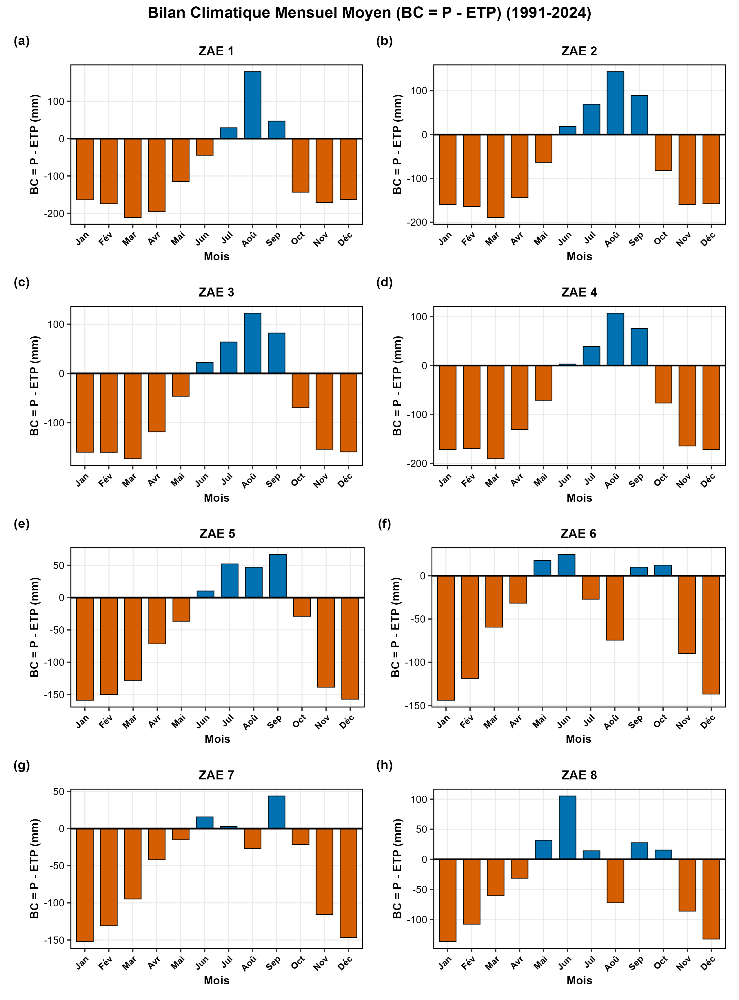
<figcaption>
<strong>Figure 15:</strong> Évolution mensuelle du bilan
climatique moyen (BC = P - ETP, en mm) dans les huit ZAE du Bénin
(1991-2024)
</figcaption>
</figure>

**Indices d'anomalie normalisée de Lamb (pluviométrie et température)**

La figure 16 présente l’évolution de l’indice pluviométrique centré
réduit de Lamb entre 1991 et 2024. Cet indice permet de mettre en
évidence les périodes de déficit et d’excédent pluviométrique par
rapport aux conditions moyennes de la période étudiée. Les résultats
mettent en évidence une succession de séquences climatiques contrastées,
sans tendance unidirectionnelle durable à l’échelle nationale.

Entre 1991 et 2002, une phase globalement sèche est observée, marquée
par plusieurs années de déficit pluviométrique. Les déficits les plus
sévères sont enregistrés en 1992, 1996, 1998 et 2001, avec des valeurs
de l’indice inférieures à -1,5. Cette période est toutefois ponctuée de
quelques excédents isolés, notamment en 1994 dans le Nord du pays, où
l’indice dépasse +1,7, et en 1999 dans le Sud.

Entre 2003 et 2012, une phase globalement humide est observée sur une
grande partie du territoire. Les années 2003, 2008, 2010 et 2012 se
caractérisent par des valeurs de l’indice supérieures à +1,5, atteignant
jusqu’à +2,1 dans certaines zones. Cette période traduit une succession
d’années à cumuls pluviométriques relativement élevés.

Entre 2013 et 2017, un retour marqué de la sécheresse est observé sur
l’ensemble du pays. Les déficits sont particulièrement prononcés en
2013-2014 dans la ZAE 4, où l’indice atteint environ -2,0, ainsi qu’en
2015 dans la ZAE 5, où un déficit extrême d’environ -2,8 est enregistré.
Depuis 2018, une reprise pluviométrique est observée dans le Nord et le
Centre du pays, notamment dans les ZAE 1 à 5. Les années 2018-2020 et
2024 se caractérisent par des valeurs de l’indice supérieures à +1,0. En
revanche, dans la partie méridionale du pays, les fluctuations restent
plus proches de la normale, sans excédents ou déficits aussi marqués que
dans les zones septentrionales et centrales.

<figure>
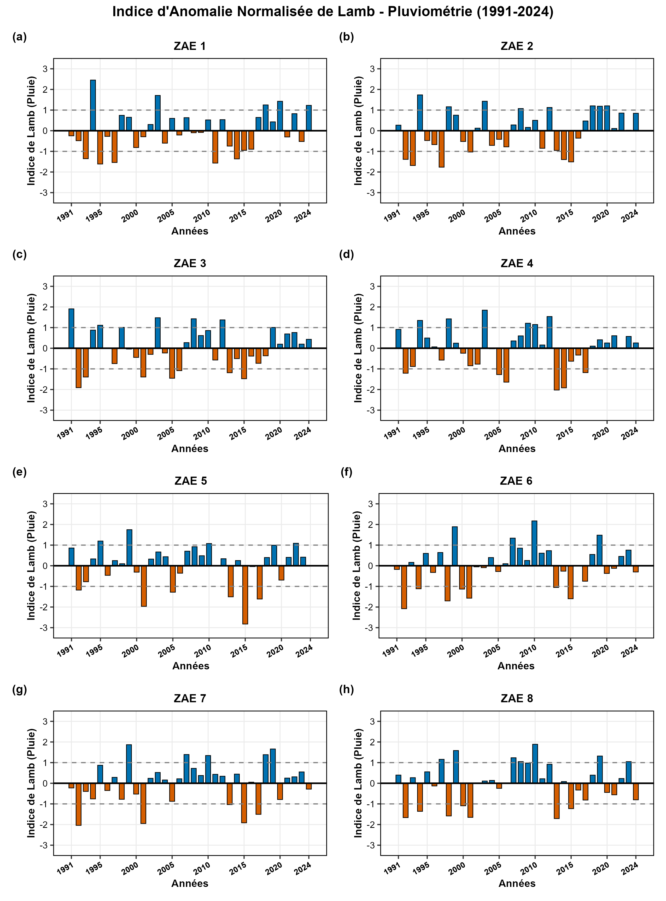
<figcaption>
<strong>Figure 16:</strong> Variation interannuelle de
l’indice d’anomalie normalisée de Lamb appliqué aux précipitations dans
les huit ZAE du Bénin (1991-2024)
</figcaption>
</figure>

La figure 17 présente l’évolution de l’indice de Lamb de la température
moyenne dans les huit Zones Agro-Écologiques (ZAE) du Bénin entre 1991
et 2024. Contrairement à la variabilité cyclique observée pour les
précipitations, les résultats mettent en évidence une évolution
thermique plus régulière, marquée par une rupture nette et synchrone sur
l’ensemble du territoire.

La série 1991-2024 se caractérise par deux grandes phases. Entre 1991 et
2004, les anomalies thermiques sont globalement négatives, traduisant
des conditions relativement plus fraîches par rapport à la moyenne de la
période étudiée. Cette tendance est particulièrement marquée entre 1991
et 1995 dans les ZAE 1 à 4, où les valeurs de l’indice varient entre
-1,5 et -2,4.

Entre 2005 et 2014, une phase de transition est observée. Les anomalies
négatives diminuent progressivement, tandis que les températures
augmentent. Cette période traduit une évolution intermédiaire entre le
régime relativement frais du début de la série et le régime chaud qui
s’installe par la suite.

À partir de 2015-2016, un basculement durable vers un régime thermique
plus chaud est observé sur l’ensemble du territoire. Depuis 2016, la
quasi-totalité des années présentent des anomalies positives, atteignant
des valeurs comprises entre +1,5 et +2,4 lors des années récentes,
notamment en 2019, 2020, 2021, 2023 et 2024. Ces valeurs traduisent des
conditions thermiques chaudes à extrêmement chaudes par rapport à la
moyenne de la période 1991-2024.

<figure>
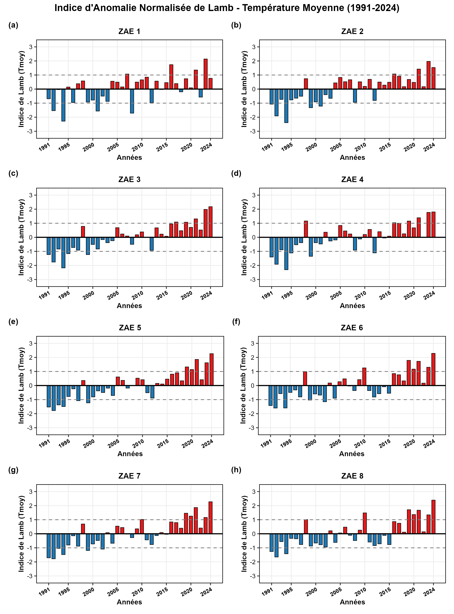
<figcaption>
<strong>Figure 17:</strong> Variation interannuelle de
l’indice d’anomalie normalisée de Lamb appliqué à la température moyenne
dans les huit ZAE du Bénin (1991-2024)
</figcaption>
</figure>

**Projections climatiques CMIP6 aux horizons 2030, 2050 et 2100**

**Projection de la pluviométrie**

Les figures 18, 19 et 20 présentent les projections des cumuls
pluviométriques annuels aux horizons 2030, 2050 et 2100, selon trois
modèles climatiques globaux du projet CMIP6, à savoir ACCESS-CM2,
ACCESS-ESM1-5 et CanESM5, ainsi que quatre scénarios socio-économiques
(SSP1-2.6, SSP2-4.5, SSP3-7.0 et SSP5-8.5). Contrairement aux
températures, l’évolution future des précipitations présente une forte
incertitude entre les modèles et une importante variabilité spatiale.

Le modèle CanESM5 (Figure 20) simule une augmentation générale des
précipitations, particulièrement sous les scénarios moyens à élevés. Les
cumuls annuels passent d’environ 1 100 à 1 200 mm en 2030 à près de 1
500 mm dans la ZAE 1 et 1 600 mm dans les ZAE 2 à 4 à l’horizon 2100.
Cette évolution traduit une humidification progressive du Nord et du
Centre-Nord du pays selon ce modèle.

À l’inverse, le modèle ACCESS-ESM1-5 (Figure 19) projette une diminution
générale des précipitations à l’horizon 2100 sous le scénario SSP5-8.5,
dans l’ensemble des ZAE. La baisse est estimée entre 40 et 65 mm par an
par rapport aux valeurs projetées en 2030. Ce résultat traduit une
possible intensification des conditions sèches à long terme selon ce
modèle.

Le modèle ACCESS-CM2 (Figure 18) met en évidence un contraste spatial
entre le Nord et le Sud du pays, particulièrement sous les scénarios
SSP3-7.0 et SSP5-8.5. Dans les ZAE 1 à 4, une augmentation des
précipitations est projetée, avec des valeurs comprises entre +70 et
+110 mm par an à l’horizon 2100. À l’inverse, dans les ZAE 6 à 8, une
diminution plus marquée est observée, avec des baisses comprises entre
-40 et -75 mm par an. Ce contraste traduit une possible divergence des
évolutions pluviométriques entre le Nord et le Sud du pays.

Sous le scénario SSP1-2.6, les précipitations restent globalement
stables par rapport aux valeurs projetées en 2030, dans les trois
modèles. Ce résultat traduit une relative stabilité des conditions
pluviométriques dans un scénario d’émissions faibles.

Dans l’ensemble, ces résultats mettent en évidence une forte incertitude
concernant l’évolution future des précipitations au Bénin. Cette
incertitude est liée à la diversité des modèles climatiques et des
scénarios socio-économiques considérés.

<figure>
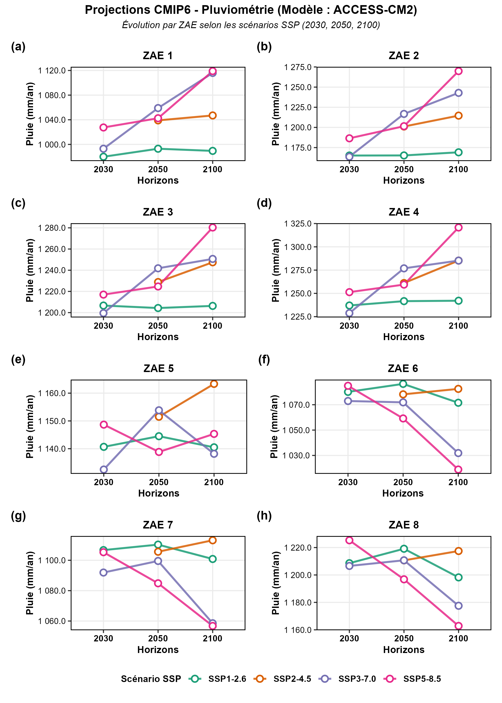
<figcaption>
<strong>Figure 18:</strong> Projections des
précipitations annuelles (mm/an) aux horizons 2030, 2050 et 2100 dans
les huit ZAE du Bénin selon le modèle ACCESS-CM2.
</figcaption>
</figure>

<figure>
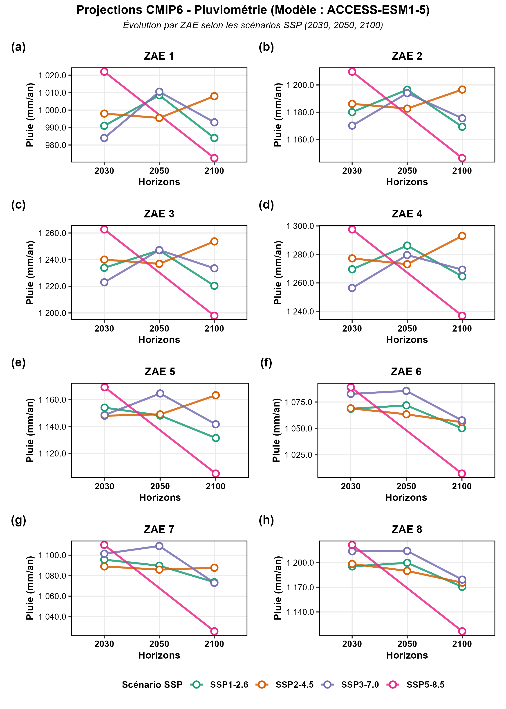
<figcaption>
<strong>Figure 19:</strong> Projections des
précipitations annuelles (mm/an) aux horizons 2030, 2050 et 2100 dans
les huit ZAE du Bénin selon le modèle ACCESS-ESM1-5.
</figcaption>
</figure>

<figure>
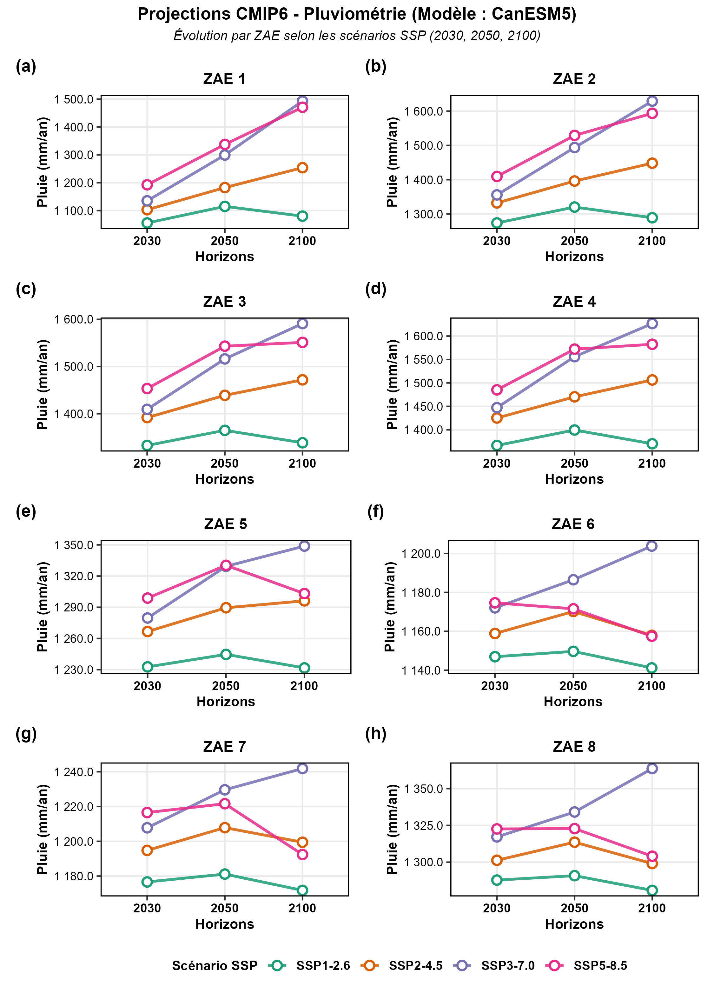
<figcaption>
<strong>Figure 20:</strong> Projections des
précipitations annuelles (mm/an) aux horizons 2030, 2050 et 2100 dans
les huit ZAE du Bénin selon le modèle CanESM5.
</figcaption>
</figure>

**Projections des températures moyennes
(**$`\mathbf{T}_{\mathbf{moy}}`$**)**

Les figures 21, 22 et 23 présentent les projections des températures
moyennes annuelles ($`T_{moy}`$) aux horizons 2030, 2050 et 2100 dans
les huit Zones Agro-Écologiques (ZAE) du Bénin, selon les modèles
ACCESS-CM2, ACCESS-ESM1-5 et CanESM5, ainsi que les scénarios SSP1-2.6,
SSP2-4.5, SSP3-7.0 et SSP5-8.5. L’ensemble des simulations met en
évidence un réchauffement continu et généralisé sur l’ensemble du
territoire, dont l’amplitude augmente avec le niveau de forçage radiatif
des scénarios et selon un gradient croissant du Sud vers le Nord.

À court et moyen termes, les trajectoires restent relativement proches
entre les scénarios. En 2030, les températures moyennes annuelles se
situent entre 29,9 et 30,4 °C dans la ZAE 1 et entre 27,8 et 29,1 °C
dans les ZAE 2 à 8. D’ici 2050, l’augmentation est de +0,3 à +0,7 °C
sous le scénario SSP1-2.6, contre +1,1 à +1,9 °C sous le scénario
SSP5-8.5. Cette évolution traduit une accélération progressive du
réchauffement selon le niveau d’émissions considéré.

À l’horizon 2100, les écarts entre les scénarios deviennent plus
importants. Sous le scénario SSP1-2.6, le réchauffement tend à se
stabiliser après 2050. Les températures moyennes annuelles restent alors
comprises entre 30,5 et 31,3 °C dans la ZAE 1 et entre 29,0 et 29,4 °C
sur le littoral, dans la ZAE 8. Sous le scénario SSP2-4.5, les
températures atteignent 31,8 à 32,6 °C dans la ZAE 1 et 29,7 à 31,1 °C
dans les ZAE 2 à 8.

Sous le scénario SSP5-8.5, le réchauffement est nettement plus marqué. À
l’horizon 2100, les températures moyennes annuelles atteignent 33,9 à
35,3 °C dans la ZAE 1, 31,8 à 34,0 °C dans les ZAE 2 à 5 et 31,3 à 33,7
°C dans les ZAE 6 à 8. Les augmentations les plus prononcées sont
simulées par les modèles ACCESS-CM2 et CanESM5, qui dépassent les
projections d’ACCESS-ESM1-5 d’environ 1,2 à 2,0 °C.

<figure>
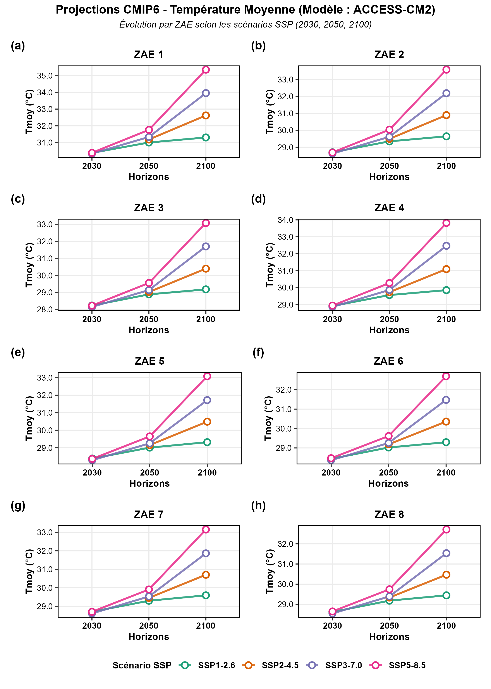
<figcaption>
<strong>Figure 21:</strong> Projections de la température
moyenne (°C) aux horizons 2030, 2050 et 2100 dans les huit ZAE du Bénin
selon le modèle ACCESS-CM2.
</figcaption>
</figure>

<figure>
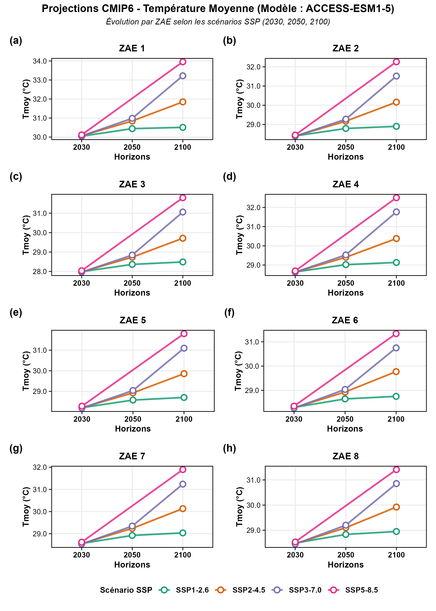
<figcaption>
<strong>Figure 22:</strong>Projection de la température
moyenne (°C) aux horizons 2030, 2050 et 2100 dans les huit ZAE du Bénin
selon le modèle ACCESS-ESM1-5.
</figcaption>
</figure>

<figure>
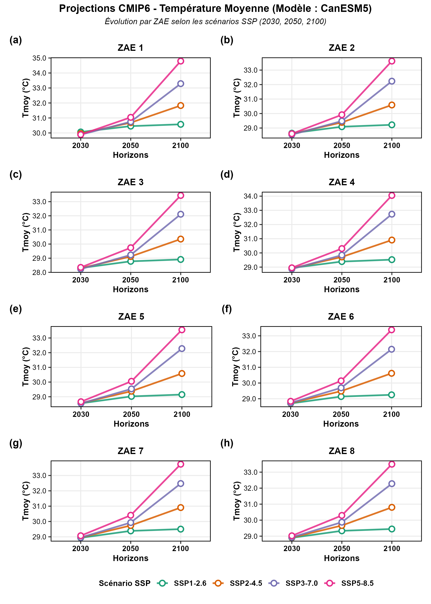
<figcaption>
<strong>Figure 23:</strong> Projections de la température
moyenne (°C) aux horizons 2030, 2050 et 2100 dans les huit ZAE du Bénin
selon le modèle CanESM5.
</figcaption>
</figure>

**Projections des températures moyennes
(**$`\mathbf{T}_{\mathbf{\max}}`$**)**

Les figures 24, 25 et 26 présentent les projections des températures
maximales annuelles ($`T_{\max}`$) aux horizons 2030, 2050 et 2100,
selon les modèles ACCESS-CM2, ACCESS-ESM1-5 et CanESM5. Les résultats
mettent en évidence une intensification marquée des chaleurs diurnes sur
l’ensemble du territoire, particulièrement dans la partie septentrionale
du pays.

En 2030, les températures maximales moyennes annuelles se situent entre
35,8 et 36,9 °C dans la ZAE 1, entre 33,6 et 35,0 °C dans les ZAE 2 à 4,
et entre 32,1 et 34,0 °C dans les ZAE 5 à 8. D’ici 2050, les valeurs
atteignent 36,3 à 38,1 °C dans la ZAE 1 et 32,6 à 35,3 °C dans les ZAE 6
à 8, selon le scénario considéré.

À l’horizon 2100, les écarts entre les scénarios deviennent plus
importants. Sous le scénario SSP1-2.6, les températures maximales
restent comprises entre 36,7 et 37,7 °C dans la ZAE 1 et entre 32,8 et
33,4 °C dans la ZAE 8. En revanche, sous les scénarios SSP3-7.0 et
SSP5-8.5, les températures maximales augmentent de manière plus marquée.
Dans la ZAE 1, la température maximale moyenne annuelle atteint 40,0 à
41,4 °C sous le scénario SSP5-8.5, soit une augmentation de +3,8 à +4,7
°C par rapport aux valeurs projetées en 2030. Dans les ZAE 2 à 4, les
valeurs atteignent 37,6 à 39,7 °C, tandis qu’elles varient entre 37,1 et
39,0 °C dans la ZAE 5 et entre 35,1 et 38,6 °C dans les ZAE 6 à 8.

<figure>
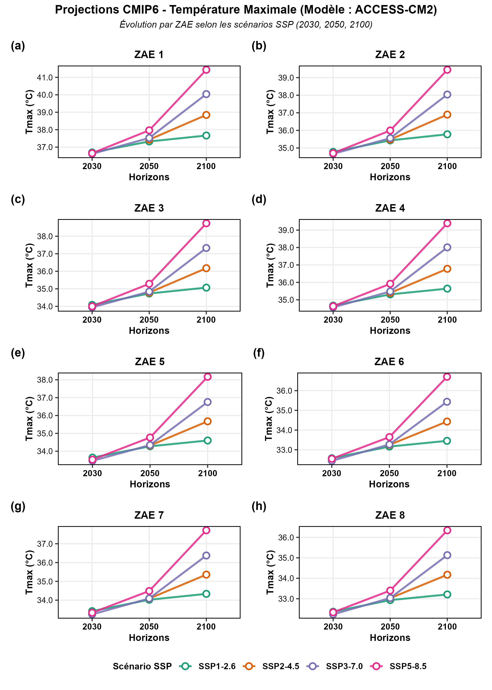
<figcaption>
<strong>Figure 24:</strong> Projections de la température
maximale (°C) aux horizons 2030, 2050 et 2100 dans les huit ZAE du Bénin
selon le modèle ACCESS-CM2.
</figcaption>
</figure>

<figure>
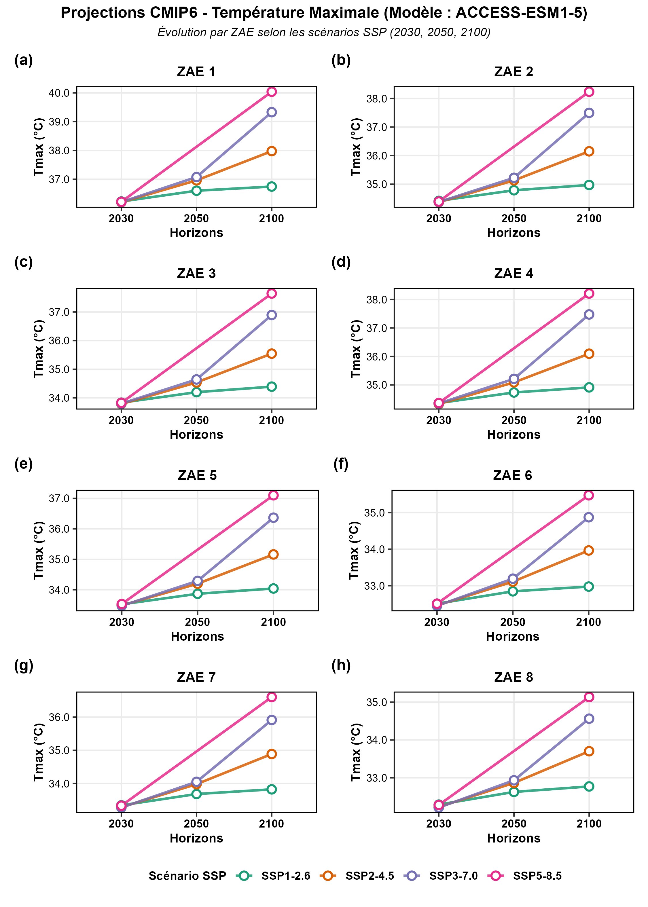
<figcaption>
<strong>Figure 25:</strong> Projection de la température
maximale (°C) aux horizons 2030, 2050 et 2100 dans les huit ZAE du Bénin
selon le modèle ACCESS-ESM1-5.
</figcaption>
</figure>

<figure>
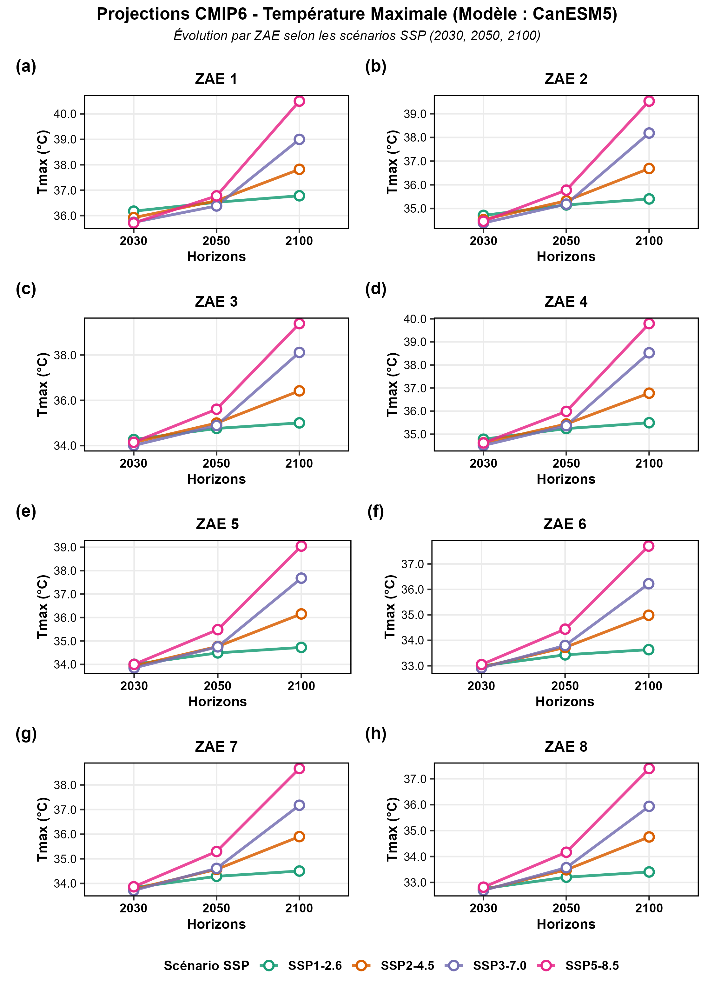
<figcaption>
<strong>Figure 26:</strong> Projections de la température
maximale (°C) aux horizons 2030, 2050 et 2100 dans les huit ZAE du Bénin
selon le modèle CanESM5.
</figcaption>
</figure>

**Projections des températures minimales
(**$`\mathbf{T}_{\mathbf{\min}}`$**)**

Les figures 27, 28 et 29 présentent les projections des températures
minimales annuelles ($`T_{\min}`$) aux horizons 2030, 2050 et 2100,
selon les modèles ACCESS-CM2, ACCESS-ESM1-5 et CanESM5. Les résultats
mettent en évidence un réchauffement nocturne continu et relativement
homogène sur l’ensemble du territoire. Cette évolution traduit une
atténuation progressive de la fraîcheur nocturne, y compris durant la
période de l’harmattan.

En 2030, les températures minimales moyennes annuelles varient entre
22,0 et 22,7 °C dans les ZAE 2 et 3, entre 22,8 et 24,6 °C dans les ZAE
1 et 4 à 7, et entre 24,6 et 25,2 °C sur la bande côtière, dans la ZAE
8. À l’horizon 2050, les températures minimales augmentent de +0,5 à
+0,8 °C sous le scénario SSP1-2.6, contre +1,2 à +1,9 °C sous le
scénario SSP5-8.5. Elles atteignent alors 25,3 à 25,9 °C dans la ZAE 1
et 26,1 à 26,4 °C dans la ZAE 8.

À l’horizon 2100, les écarts entre les scénarios deviennent plus
importants. Sous le scénario SSP1-2.6, les températures minimales
restent comprises entre 24,3 et 24,9 °C dans la ZAE 1 et entre 25,1 et
25,7 °C sur le littoral, dans la ZAE 8. Sous le scénario SSP5-8.5, elles
atteignent 27,9 à 29,2 °C dans la ZAE 1, 25,9 à 28,3 °C dans les ZAE 2 à
5 et 27,2 à 29,6 °C dans les ZAE 6 à 8. Les augmentations les plus
prononcées sont observées avec les modèles ACCESS-CM2 et CanESM5, en
lien avec leur sensibilité climatique plus élevée.

<figure>
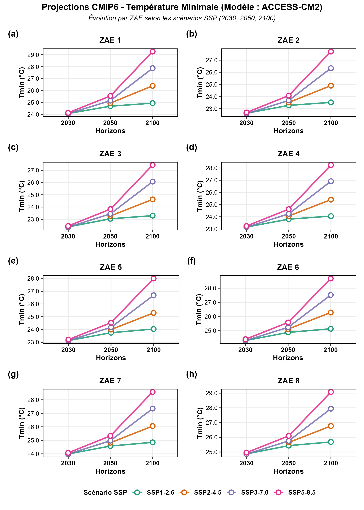
<figcaption>
<strong>Figure 27:</strong>Projections de la température
minimale (°C) aux horizons 2030, 2050 et 2100 dans les huit ZAE du Bénin
selon le modèle ACCESS-CM2.
</figcaption>
</figure>

<figure>
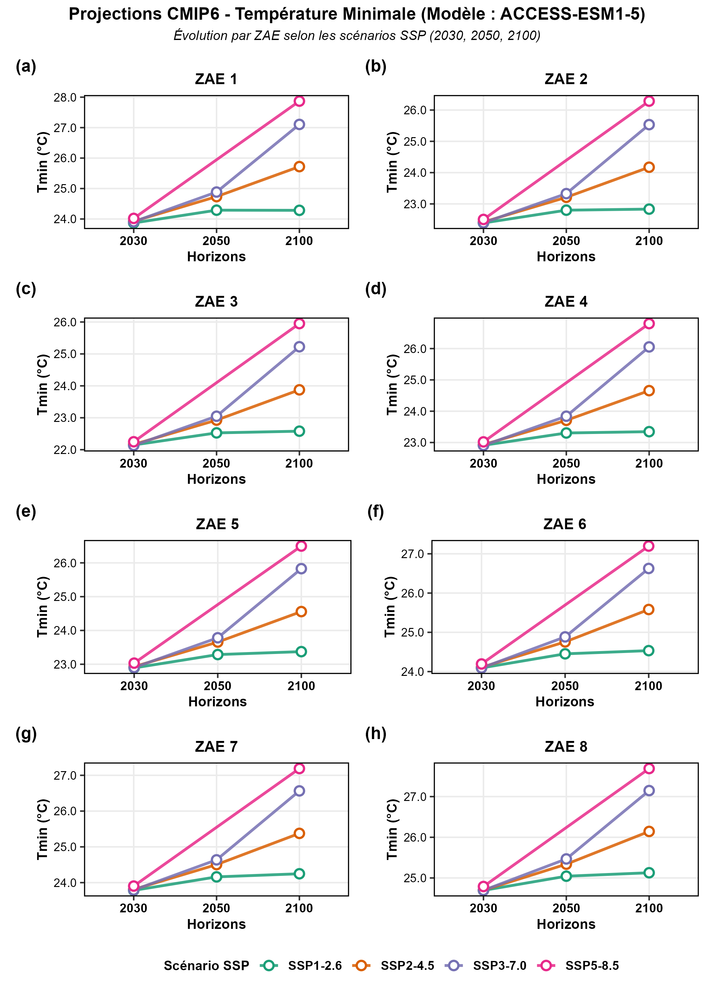
<figcaption>
<strong>Figure 28:</strong> Projection de la température
minimale (°C) aux horizons 2030, 2050 et 2100 dans les huit ZAE du Bénin
selon le modèle ACCESS-ESM1-5.
</figcaption>
</figure>

<figure>
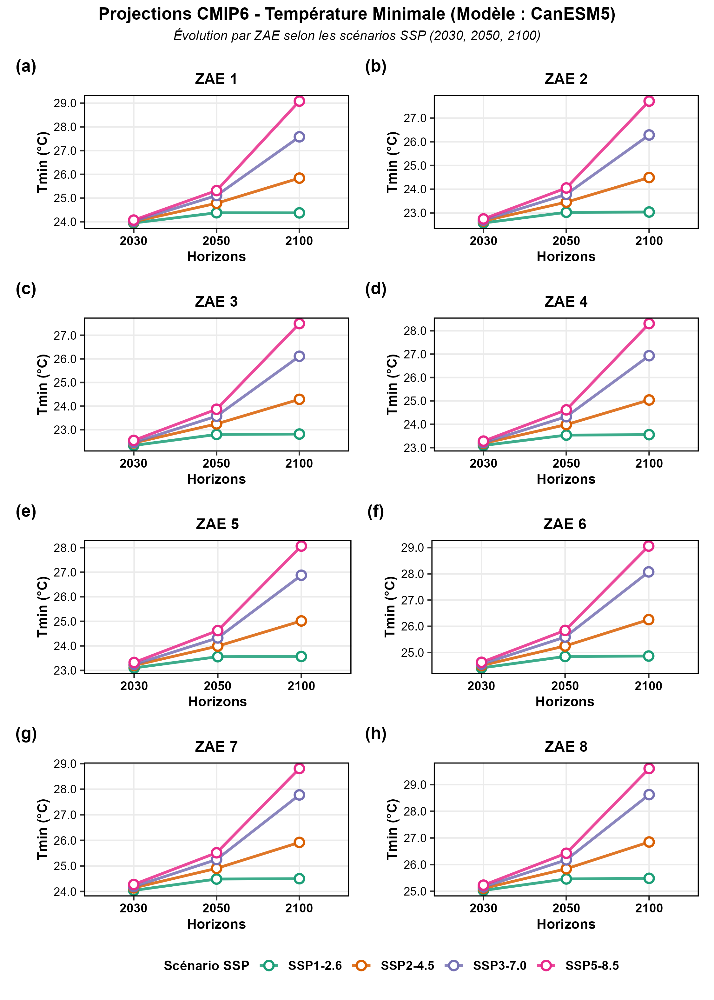
<figcaption>
<strong>Figure 29:</strong> Projections de la température
minimale (°C) aux horizons 2030, 2050 et 2100 dans les huit ZAE du Bénin
selon le modèle CanESM5.
</figcaption>
</figure>

**Indice Standardisé de Précipitation-Évapotranspiration à l’échelle de
12 mois (SPEI-12)**

La figure 30 présente l’évolution de l’Indice Standardisé de
Précipitation-Évapotranspiration à l’échelle de 12 mois (SPEI-12) dans
les huit Zones Agro-Écologiques (ZAE) du Bénin entre 1991 et 2024. Cet
indice intègre à la fois les précipitations et l’évapotranspiration
potentielle, ce qui permet de caractériser les périodes de déficit
hydrique ($`SPEI < 0`$, en orange) et d’excédent hydrique ($`SPEI > 0`$,
en bleu). Les épisodes de sécheresse sévère à extrême correspondent aux
valeurs inférieures à -1,5, tandis que les périodes humides sévères à
extrêmes correspondent aux valeurs supérieures à +1,5. Sur l’ensemble de
la période étudiée, la répartition entre les conditions sèches et
humides apparaît globalement équilibrée, avec une légère prédominance
des conditions déficitaires. La proportion de mois en déficit hydrique
varie entre 50,5% et 53,0% selon les ZAE. Toutefois, cette répartition
masque une forte variabilité interannuelle et décennale, ainsi qu’une
organisation spatiale contrastée entre le Nord, le Centre et le Sud du
pays. Au début des années 1990, entre 1992 et 1994, un déficit hydrique
généralisé est observé sur l’ensemble du territoire. Les sécheresses
sont particulièrement marquées dans le Sud, avec des valeurs de SPEI-12
atteignant -2,72 dans la ZAE 7 en 1992, -2,06 dans la ZAE 6 et -1,92
dans la ZAE 8. Cette période est suivie d’une phase plus humide entre
1995 et 1996, particulièrement dans le Nord et le Centre du pays. Les
valeurs maximales sont observées dans la ZAE 1, avec un SPEI-12 de
+2,36, et dans la ZAE 3, avec +2,12. Entre 2000 et 2013, une opposition
spatiale est observée entre les différentes zones. Dans le Centre et le
Sud, plusieurs épisodes d’excédent hydrique sont enregistrés, notamment
en 1999-2000, avec des valeurs de +2,70 dans la ZAE 5 et +2,10 dans la
ZAE 7, puis autour de 2010-2012, avec des valeurs de +2,46 dans la ZAE 6
et +2,30 dans la ZAE 8. À l’inverse, les zones septentrionales et
centrales, notamment les ZAE 1 à 4, connaissent des épisodes de
sécheresse récurrents en 1998, 2002 et surtout en 2006-2007. Les valeurs
minimales atteignent -2,12 dans la ZAE 3 et -2,24 dans la ZAE 4.

À partir de 2014, une recrudescence des sécheresses sévères est observée
sur la quasi-totalité du territoire. L’épisode de 2014-2017 affecte
particulièrement le Nord et le Centre du pays, avec des valeurs
minimales de -2,20 dans la ZAE 1, -2,24 dans la ZAE 2 et -2,42 dans la
ZAE 5. Cette phase de sécheresse se prolonge ensuite dans la partie
méridionale, avec des déficits répétés en 2018-2019 et en 2021-2022,
notamment dans les ZAE 5 à 8.

À partir de 2019, une reprise pluviométrique modérée est observée dans
l’Extrême-Nord, notamment dans les ZAE 1 et 2, avec des valeurs de
SPEI-12 supérieures à +1,5 en 2020-2021. En revanche, dans les autres
zones, les conditions restent plus variables, avec une alternance de
périodes sèches et humides.

<figure>
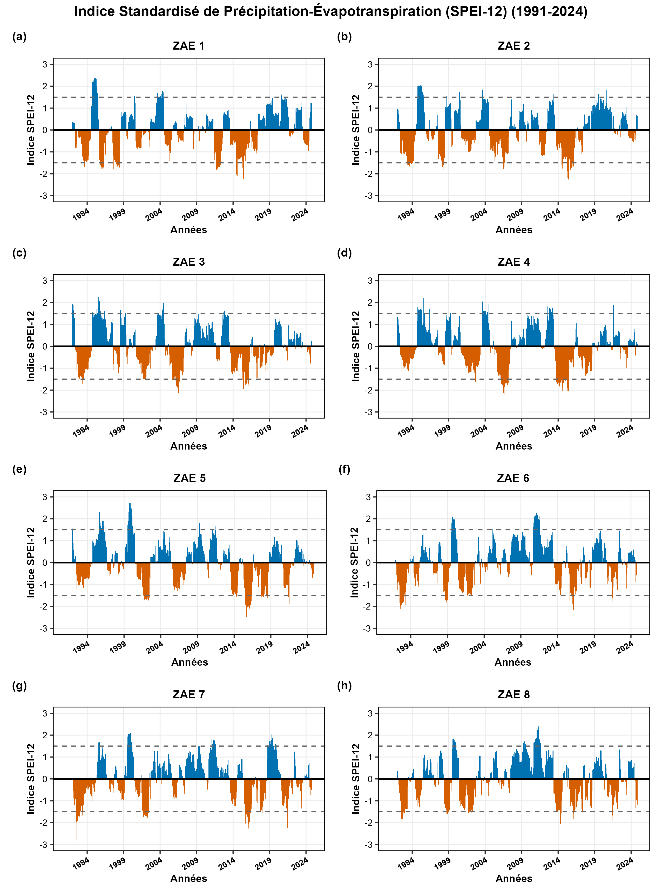
<figcaption>
<strong>Figure 30:</strong> Indice Standardisé de
Précipitation-Évapotranspiration à l’échelle de 12 mois (SPEI-12) dans
les huit Zones Agro-Écologiques (ZAE) du Bénin
</figcaption>
</figure>
